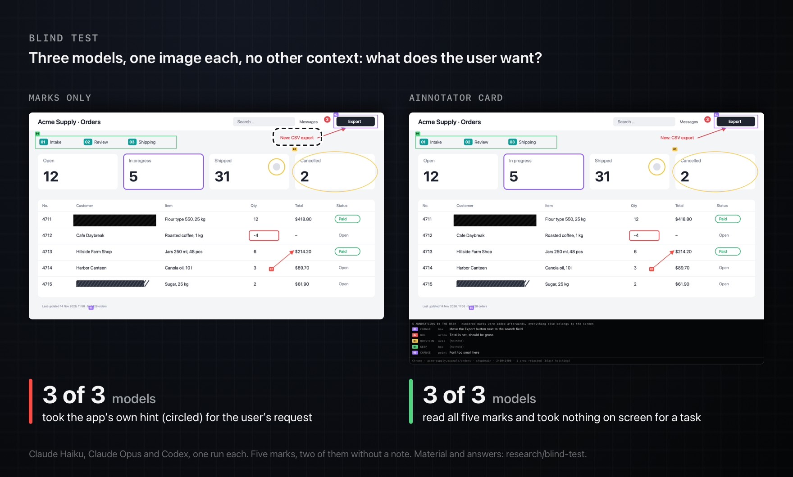

# AInnotator

### Show, don't type.

AInnotator lives in your Mac's menu bar. Press `⌥⇧A`, mark what you mean right on the screen, press `↵` twice, and paste one image into Claude Code, Codex, claude.ai or ChatGPT. The image explains itself, so you don't have to.

![A checkout page with a total of $0.00. Option-Shift-A freezes the screen, a drag selects the page, then a purple box "Apply next to the field", a red arrow to the total "Should be $46.35", a blacked-out e-mail address, a green box around the delivery options and a yellow oval "Real stock?" around an "Only 2 left" badge. Return twice copies it. In the terminal, Command-V gives "[Image #1] fix these", and below it the card: the screenshot with numbered marks and a legend listing all four.](assets/readme/hero.gif)

<a href="https://github.com/porco-rs/ainnotator/releases/latest/download/AInnotator.dmg"></a>

Free and open source · everything stays on your Mac, unless you let it copy a capture to the machine you're working on · [release notes and checksum](https://github.com/porco-rs/ainnotator/releases/latest)

Needs macOS 26 or later on Apple silicon, and permission to record the screen.

---

You've found the bug. You take a screenshot, paste it into the chat and start typing: *the total at the bottom right is wrong, and the Apply link should sit next to the coupon field, and leave the delivery options alone, those are fine.* The model answers with confidence and fixes something else. Your red arrow looked just like the app's own red badge.

So point instead. `⌥⇧A`, a box, an arrow, three words if you feel like it, `↵ ↵`, `⌘V`. The model gets one picture: your marks, numbered, and a legend that says what each of them means.

## What you get

### Marks that mean something

Draw a box, an oval, an arrow or a highlight, or click to drop a numbered point. Every mark gets a number, and its color says what you want:

**red** bug · **purple** change · **green** keep · **yellow** question

Press `1` to `4` to switch. Type a few words if you like; a mark without a note still counts. `X` blacks out what nobody should see, `C` crops.

### An image that explains itself


Below your screenshot, the card lists every mark with its number, intent and shape, including the ones you left without a note. Its header line reads *4 annotations by the user · numbered marks were added afterwards, everything else belongs to the screen*. The footer says where it came from: the app, the page or repository, and how many areas you blacked out.

That header line does more work than it seems to.



Three models, Claude Haiku, Claude Opus and Codex, each got one image, no project knowledge, and the question of what the user wants. The screen was built to mislead: a red hint arrow, numbered step chips, a purple focus ring, all part of the app. With the marks alone, all three took the app's own hint for the user's request. With the card, all three read all five marks correctly, including the two without a note, and none mistook anything on the screen for a task.

It's one screen, one run per model, and the question itself pointed at the difference, so it's a small test. It's also why the card looks the way it does. The screen, the question and every answer are in [research/blind-test](research/blind-test).

### One `⌘V`, every target

![Command-V, the same image everywhere. Left, a terminal shows "[Image #1] fix these", with the card below as what [Image #1] carries. Right, a chat page in a browser has the card attached in its message box.](assets/readme/everywhere.png)

AInnotator puts the card on the clipboard the way Finder copies a file. Each app takes what it can use: a browser gets the picture, a terminal gets the file's path, and Claude Code and Codex turn that path into `[Image #1]`. You don't pick a format, and there's nothing to set up.

Checked by hand: Claude Code and Codex in Ghostty; claude.ai, ChatGPT and Claude Design in Chrome; and Safari.

### When the agent runs on another machine

If your terminal is connected to another machine over SSH, AInnotator copies the card there and puts the path on that machine on the clipboard. `⌘V` still does the rest: Claude Code or Codex over SSH shows `[Image #1]`, as it does on your Mac. Switch to a browser, and the same `⌘V` pastes the picture again.

It works through your own SSH setup, so your keys, config and shared connections count as they do when you type `ssh` yourself. The card goes into a private folder, `~/.ainnotator`, on that machine; older cards are removed there after the same 1, 7 or 30 days, the next time one is copied. Only the finished card goes, with redacted areas already blacked out.

The first time for each machine, the receipt asks whether it may copy there. Until you say yes, nothing connects. If the machine doesn't take the copy, or wants a password, everything stays local and the receipt says so; `⌘V` pastes the local file as before. Settings let you turn it off and forget the machines you confirmed.

It needs a terminal AInnotator can read the connection from: Ghostty, Terminal or iTerm. Not covered: the terminal inside VS Code, mosh, a `tmux` you started before `ssh`, and cloud environments without SSH.

Checked by hand: Claude Code in Ghostty, against a test machine.

### Fast, then out of the way

On the maker's Mac, measured on 14 November 2026: the frozen screen appears about 50 ms after `⌥⇧A`, the clipboard is filled less than 1 ms after `↵`, and the finished card is ready about 50 ms later. At rest the app uses 15 MB. That's one Mac, so read these numbers as a sketch.

### Redaction that stays redacted

Press `X` and drag over anything private. AInnotator overwrites those pixels in its own copy before the image is written, and the unredacted capture is never saved. The footer tells the model how many areas were blacked out, so it doesn't wonder why.

## Your first minute

1. **[Download the DMG](https://github.com/porco-rs/ainnotator/releases/latest/download/AInnotator.dmg)**, open it, and drag AInnotator to Applications.

2. **Open it.** A small icon appears in the menu bar: four corners and a dot.

3. **Press `⌥⇧A`.** The first time, macOS asks for permission to record the screen. Allow AInnotator under System Settings › Privacy & Security, then press `⌥⇧A` again.

4. **Drag over an area, mark it, press `↵ ↵`.** A small receipt in the top right corner shows what's on the clipboard. Now `⌘V` wherever you want it.

After your first capture from a browser or a terminal, macOS may ask whether AInnotator may control that app (**Automation**). That's how the footer learns the page address, or the repository and branch you're in. Say no, and the footer simply leaves them out.

Settings let you start AInnotator at login, choose how long captures are kept, and say whether they may be copied to a remote machine. There's no built-in updater: choose **Watch → Custom → Releases** at the top of this page, and GitHub tells you when a new version is out.

Official releases come only from [this repository's releases](https://github.com/porco-rs/ainnotator/releases), signed by Leon Schwahn.

<details>
<summary>Check it before you trust it</summary>

Every release is a signed and notarized DMG, published with its SHA-256 checksum on the [releases](https://github.com/porco-rs/ainnotator/releases) page.

Compare the published checksum with your download:

```sh
shasum -a 256 AInnotator.dmg
```

Inspect the installed app's signature:

```sh
codesign -dv /Applications/AInnotator.app
```

It should show `TeamIdentifier=DLYUZB2S4C`.

</details>

## Everything stays on your Mac

Your screen shows things that aren't yours to share: customer data, tokens, someone else's e-mail. So everything stays on your Mac, unless you let a capture be copied to the machine you're working on. That happens only after you confirm the machine, and only with the finished card. There's no account and no telemetry, and the source is right here.

Here is everything AInnotator reads, and why:

- **the screen**, when you press `⌥⇧A`, to freeze it while you mark. It also takes one throwaway capture when it starts, after your Mac wakes and after you unlock it, so your first `⌥⇧A` is fast. That capture is never shown or saved.
- **the name of the app in front**, for the footer. Its window title too, but only if you have given AInnotator Accessibility access yourself; the app never asks for it, and the title goes only into the JSON file
- **the address of the front tab** in Safari, Chrome or Arc, without the query and fragment, so no tokens end up in your prompt
- **the repository and branch** of the folder your last-used terminal is in; Ghostty, Terminal and iTerm tell it which folder that is
- **the connection of that terminal**, if it is an `ssh` session: the machine and the options of that `ssh` call, read from the running process. Only a fixed list of options is reused; anything that could run a command is dropped

And everything it writes:

- **`~/.ainnotator/`**: each capture as a PNG, with a JSON file of the same marks next to it. Both are deleted automatically after 1, 7 or 30 days; 7 is the default.
- **`~/.ainnotator/` on the other machine**, only after you confirm that machine: the finished card as a PNG, through your own `ssh`. Older cards are removed there after the same 1, 7 or 30 days, the next time one is copied. No JSON, no unredacted image, no keys.
- **the clipboard**: one item, like a file copied in Finder, holding the file, the picture and its path. While a terminal connected to a confirmed machine is in front, it holds the picture and the path on that machine instead, and goes back to the file when another app comes to the front.

## The keys

| Anywhere | |
|---|---|
| `⌥⇧A` | mark an area |
| `⌥⇧R` | mark the last area again |

| Choosing the area | |
|---|---|
| drag | select an area |
| click | the whole display |
| `Space` | the window under the pointer |
| `R` | the last area |
| `esc` | cancel |

| Marking | |
|---|---|
| drag | draw with the current tool |
| click | drop a numbered point |
| `B` `O` `A` `H` | box, oval, arrow, highlight |
| `X` `C` | redact, crop |
| `1` `2` `3` `4` | bug, change, keep, question |
| type | a note for the active mark, up to 140 characters |
| `↵` | finish the note; `↵` again copies and closes |
| `⌘C` | copy and close right away |
| `esc` | leave the note; with nothing open, cancel |

<details>
<summary>More keys</summary>

| | |
|---|---|
| `⇥` `⇧⇥` | next or previous mark, with its note |
| `←` `↑` `↓` `→` | move the selected mark by 1 pt, with `⇧` by 10 |
| `⌫` | delete the selected mark |
| `⌘Z` `⇧⌘Z` | undo, redo |
| `?` | show all the keys |

</details>

## Questions you may have

**Why not just a screenshot with arrows?**
Because a model can't tell your arrow from the app's. In the blind test above, every model that saw marks without the legend followed a hint that belonged to the app. The legend is what fixes that.

**Will it work with my AI tool?**
It works with the ones listed above, all checked by hand. Anything that accepts a pasted picture or an image path will probably work too, but that's a guess. The Claude and ChatGPT desktop apps haven't been tried yet.

**Which languages does it speak?**
English and German, in the menus, the overlay and the card's legend. Your notes stay in whatever language you type them. AInnotator follows your Mac's language: German if that is your first language, English otherwise.

**Does it work over SSH?**
Yes, with a terminal connected by `ssh` in front. AInnotator copies the finished card to a private folder on that machine, through your own SSH setup, and pastes the path there. It asks once for each machine, and without your yes nothing connects. If the machine doesn't take the copy, the capture stays on your Mac. The terminal inside VS Code, mosh and cloud environments without SSH aren't covered.

**Is this an Electron app?**
No. It's Swift with AppKit and Core Animation (SwiftUI only in the settings window), with no web view and no dependencies. At rest it uses 15 MB.

## Build it yourself

You'll need a Mac with Apple silicon, Xcode 26 or later, and [just](https://github.com/casey/just). Run `just app` and open `build/AInnotator.app`. Without a Developer ID certificate in your keychain the build gets an ad hoc signature, so macOS may ask for the screen permission again after each rebuild.

A pure Swift core holds state, the reducer and the output, with thin shells for rendering and the platform. Use `just build` to build, `just test` to run the tests, and `just selftest` to run the main path on an invented screen without touching your clipboard. `tools/readme-images/render.sh` redraws the images on this page from an invented screen; it needs ffmpeg.

The code is licensed under [Apache-2.0](LICENSE). See [TRADEMARKS.md](TRADEMARKS.md) for the name and icon.

## A small project, made with care

AInnotator is a personal project, maintained when time permits, and written with a lot of help from AI coding agents. I'm not accepting pull requests or feature requests. If something is broken, please [open an issue](https://github.com/porco-rs/ainnotator/issues); I can't promise a reply or a fix. If you find a security problem, please [report it privately](SECURITY.md).

---

Now go point at something.
